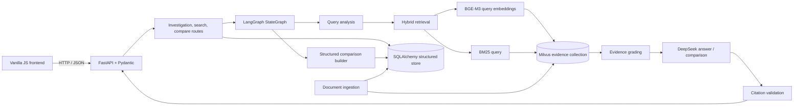
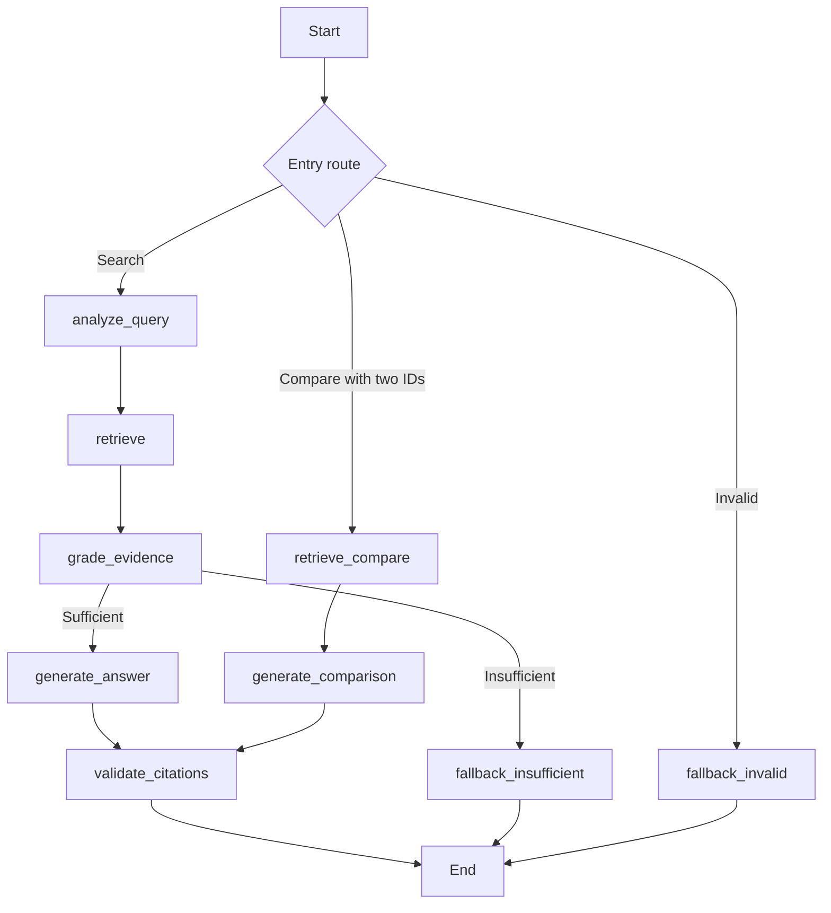

# Flame in Freefall — Winner+++

**An evidence-first research explorer for NASA microgravity combustion studies.**

For submission materials and source/AI disclosures, see [SUBMISSION.md](SUBMISSION.md). For a single-address frontend and backend demonstration, see [RUN_AND_VERIFY.md](RUN_AND_VERIFY.md).

Flame in Freefall helps researchers and curious readers search NASA combustion research, inspect the underlying evidence, and compare experimental contexts. Natural-language answers are generated from retrieved source passages, and citation records are checked against passages returned by retrieval. The system distinguishes reported information from evidence gaps; it is not a fire-safety prediction or operational tool.

> **Architecture positioning:** The project uses modular, enterprise-oriented patterns—separated API, workflow, retrieval, storage, and ingestion layers; typed contracts; centralized configuration; and source-aware AI responses. It is currently a NASA Space Apps hackathon prototype, not a production-certified enterprise service. See [Production considerations](#production-considerations).

## What it does

- **Search:** Submit a natural-language research question and receive an answer, validated citations, retrieved evidence passages, and ranked investigations.
- **Browse:** List investigations and inspect their source documents, experimental conditions, and reported findings when those records have been loaded.
- **Compare:** Select two investigations and view a fixed set of experimental dimensions with explicit availability states.
- **Trace evidence:** Inspect source IDs, document IDs, investigation IDs, and passage text used by search and comparison workflows.
- **Run API-first:** The frontend loads its investigation library and search results from FastAPI. It does not substitute bundled mock records when the API is unavailable; it shows an error and retry action instead.

## Architecture



### Backend request flow

1. FastAPI validates request and response payloads with Pydantic models.
2. LangGraph stores the request and intermediate results in a typed shared state, then routes through explicit nodes.
3. Search requests are classified, filtered, and sent to hybrid retrieval. Compare requests enter the comparison retrieval branch directly with the two selected investigation IDs.
4. Evidence is graded before answer generation. The answer generator receives retrieved passages, not an unrestricted prompt to answer from general knowledge.
5. A code-based citation validator includes only citation records that resolve to a retrieved passage; it does not rewrite the answer text itself.
6. The API returns a typed JSON response, including evidence status and citation/evidence metadata.

## Backend framework and technology stack

| Layer | Technology | Role |
|---|---|---|
| HTTP API | **FastAPI**, Uvicorn | REST endpoints, lifecycle management, CORS, interactive OpenAPI docs |
| Contracts and configuration | **Pydantic v2**, `pydantic-settings` | Request/response validation and environment-based settings |
| Workflow orchestration | **LangGraph** and LangChain Core | Explicit graph state, conditional routing, retrieval/generation stages, fallback paths |
| LLM integration | **LangChain OpenAI adapter** with a configurable OpenAI-compatible endpoint (default: DeepSeek) | Small model for query analysis/evidence grading; main model for answers/comparisons |
| Dense embeddings | **Sentence Transformers**, `BAAI/bge-m3` | 1024-dimensional text embeddings for semantic retrieval |
| Vector and keyword retrieval | **Milvus 2.5**, BM25 function, dense vector search, reciprocal-rank fusion | Semantic and lexical evidence retrieval with structured filters |
| Structured persistence | **SQLAlchemy 2**, SQLite by default | Investigation, source-document, experimental-condition, and finding records; database URL is configurable |
| Document and data ingestion | **pypdf**, `python-docx`, BeautifulSoup, Python CSV, PyMuPDF, Unstructured Transform helper | Extract document text and import experiment-condition CSV rows; the layout-analysis helper is optional and not yet wired into the current CLI |
| Frontend | HTML, CSS, vanilla JavaScript | Static, API-first research interface; deployable separately from the backend |
| Local vector infrastructure | Docker Compose, etcd, MinIO, Milvus standalone | Local development dependencies for Milvus |

## LangGraph workflow

The graph in `app/agents/graph.py` has separate paths for search, comparison, invalid input, and insufficient evidence:



The comparison route is injected by `POST /api/compare`, so it does not spend an extra model call trying to classify a comparison request. It combines SQLite-backed structured rows with an LLM-generated evidence summary. Search evidence grading uses a no-results/threshold rule first and can ask the small model to judge the remaining cases. Insufficient evidence is returned as an explicit result rather than treated as a successful factual answer.

## Retrieval and data design

- **Hybrid retrieval:** `app/retrieval/hybrid_search.py` performs dense cosine search and sparse BM25 search, then combines rankings using reciprocal-rank fusion.
- **Vector schema:** Milvus stores each evidence passage with IDs, text, dense vector, generated sparse vector, provenance, and optional experimental-condition fields. The dense index uses HNSW; the sparse field uses a sparse inverted index.
- **Embedding consistency:** BGE-M3 model, device, normalization, and dimension are centralized in settings. Changing the embedding model/dimension requires rebuilding the collection and re-ingesting the corpus.
- **Structured records:** SQLAlchemy models keep investigations, documents, experimental conditions, and reported findings separate from passage vectors. `DATABASE_URL` can be changed to another SQLAlchemy-supported database. Startup includes a small SQLite column migration, but no formal migration framework is configured.
- **Structured experiment import:** The ingestion CLI parses experimental CSV tables into test-condition records, storing recognized numeric values and units in separate columns and preserving extra columns as JSON.
- **Provenance:** Evidence IDs are generated from document IDs and chunk sequence numbers. Search responses include retrieved passages and validated citations so the UI can show where a statement came from.
- **Chunking:** The current plain-text chunker splits at paragraph boundaries, targets 1,200 characters, and overlaps 150 characters. The active CLI does not retain PDF page numbers in these chunks; page-level provenance remains future work. The separate Unstructured helper can preserve page metadata when wired into ingestion.

## API

Interactive API documentation is available at `/docs`, and the OpenAPI schema at `/openapi.json` when the backend is running.

| Method | Endpoint | Description |
|---|---|---|
| `GET` | `/health` | Liveness response |
| `GET` | `/api/investigations` | List investigations; supports `research_focus` and `material` filters |
| `GET` | `/api/investigations/{investigation_id}` | Investigation summary, documents, test conditions, and findings |
| `POST` | `/api/search` | Retrieve evidence and generate a cited answer for a research question |
| `POST` | `/api/compare` | Retrieve and compare two selected investigations |

`POST /api/compare` currently returns a flat list of `{dimension, <investigation_id>: value}` rows. The frontend normalizes these into two investigation columns with a fixed 11-field display; dimensions absent from the response are labeled as unavailable rather than inferred.

Example requests:

```bash
curl http://127.0.0.1:8000/health
curl http://127.0.0.1:8000/api/investigations
curl -X POST http://127.0.0.1:8000/api/search \
  -H 'Content-Type: application/json' \
  -d '{"question":"What materials and airflow conditions were studied?"}'
curl -X POST http://127.0.0.1:8000/api/compare \
  -H 'Content-Type: application/json' \
  -d '{"id_a":"BASS","id_b":"BASS-II"}'
```

The running service's `/openapi.json` is authoritative for actual payload shapes. [`API_CONTRACT.md`](API_CONTRACT.md) describes the intended UI contract; the frontend normalizes the backend's current flat comparison rows into the display structure described there.

## Run locally

### 1. Install Python dependencies

Use Python 3.12 or newer (the optional Unstructured Transform client in the dependency set requires Python 3.12+).

```bash
python3 -m venv .venv
source .venv/bin/activate
python -m pip install --upgrade pip
pip install -r requirements.txt
cp .env.example .env
```

Edit `.env` and set `LLM_API_KEY` to a valid key for the configured OpenAI-compatible provider. Keep `.env` private; it is ignored by Git.

### 2. Start Milvus

Docker Desktop or a Docker-compatible runtime is required.

```bash
docker compose -f docker-compose.milvus.yml up -d
```

This compose file starts Milvus standalone and its etcd and MinIO dependencies. Milvus is exposed locally on port `19530`; its health endpoint is on `9091`.

### 3. Ingest source documents

Place authorized research files in a local directory, then run the ingestion script from the repository root:

```bash
python scripts/ingest.py --source ./data/source_docs --investigation BASS-II
```

The current CLI accepts searchable PDF, DOCX, Markdown, HTML, and CSV files. CSV files are imported as experimental-condition rows; supported documents are split into text passages and indexed. If `--investigation` is omitted, the script infers an investigation from the file or parent directory. Run `python scripts/ingest.py --help` for options. It currently seeds BASS, BASS-II, BASS-M, Saffire, FLEX, SAME-R, Combustion-Guide, Fire-Incidents, and Fire-Equipment metadata.

Text-layer PDFs currently use `pypdf`; scan-only PDFs are skipped by the CLI. An Unstructured hi-res layout-analysis and title-aware chunking helper is present in `app/ingestion/unstructured_pipeline.py`, but the current CLI does not route documents through that helper. That helper requires `UNSTRUCTURED_API_KEY`. The CLI imports experimental conditions from CSV, but does not automatically extract structured findings from prose documents.

### 4. Run the API

```bash
uvicorn app.main:app --reload --reload-dir app --port 8000
```

Open [`http://127.0.0.1:8000/docs`](http://127.0.0.1:8000/docs) for the interactive Swagger UI. On startup, FastAPI creates the configured SQL tables. `/health` verifies that the API process responds; it does not verify that Milvus, the LLM provider, or an indexed corpus is ready.

### 5. Run the frontend

In another terminal, from the repository root:

```bash
python3 -m http.server 5173 --directory frontend
```

Open [`http://localhost:5173`](http://localhost:5173). For localhost, the frontend automatically calls `http://127.0.0.1:8000`. The API currently allows all CORS origins (`*`) with credentials enabled; restrict origins and review credential handling before production. The investigation list is loaded from `GET /api/investigations` at startup; if the API is missing or unavailable, the page displays a retryable error instead of mock data.

## Configuration

Settings are read from environment variables or `.env` through `app/config.py`.

| Variable | Purpose | Default / example |
|---|---|---|
| `LLM_BASE_URL` | OpenAI-compatible LLM endpoint | `https://api.deepseek.com/v1` |
| `LLM_API_KEY` | Provider secret | Set privately in `.env` or deployment secrets |
| `LLM_MODEL` | Main generation model | `deepseek-v4-flash` in `.env.example` |
| `SMALL_MODEL` | Query analysis and evidence grading model | `deepseek-v4-flash` in `.env.example` |
| `LLM_TIMEOUT_SECONDS` | LLM request timeout | `45` |
| `UNSTRUCTURED_API_KEY` | Hosted Unstructured PDF helper API key | Empty unless calling that helper |
| `UNSTRUCTURED_API_URL` | Optional Unstructured endpoint override | Empty uses the hosted default |
| `EMBEDDING_MODEL` | Sentence Transformers model | `BAAI/bge-m3` |
| `EMBEDDING_DIM` | Dense vector dimension | `1024` |
| `EMBEDDING_DEVICE` | Embedding device | `cpu` |
| `MILVUS_HOST`, `MILVUS_PORT` | Milvus address | `localhost`, `19530` |
| `MILVUS_COLLECTION` | Evidence collection | `flame_evidence` |
| `DATABASE_URL` | SQLAlchemy database URL | `sqlite:///./data/flame.db` |
| `TOP_K` | Retrieval result limit | `10` |
| `RETRIEVAL_SCORE_THRESHOLD` | Evidence grading threshold | `0.0` |
The frontend API URL is set separately in `frontend/config.js` as `window.FLAME_API_BASE_URL`. When FastAPI serves the frontend at `/`, its configuration marker selects the same origin automatically. For a separate Vercel frontend, set the deployed backend's public **HTTPS origin** (without a trailing slash). Configure allowed frontend origins with the `CORS_ORIGINS` environment variable as a JSON array. Credentialed cross-origin requests are disabled. Never place `LLM_API_KEY` in frontend code or public build variables.

## Project structure

```text
app/
  agents/       LangGraph graph, shared state, prompts, and workflow nodes
  api/          FastAPI routes and Pydantic request/response schemas
  ingestion/    File loaders, chunking, and indexing logic
  ingestion/unstructured_pipeline.py  Optional layout-aware PDF processing helpers
  retrieval/    Embeddings, hybrid search, Milvus schema/client, SQL models
  services/     LLM client factory
  config.py     Central environment-backed settings
  main.py       FastAPI app, lifespan, CORS, route registration, health endpoint
scripts/
  ingest.py     CLI for loading research files into the stores
frontend/
  index.html    Static UI structure
  app.js        API calls, state, search, comparison, and rendering
  styles.css    Responsive UI styling
  config.js     Frontend API origin configuration
API_CONTRACT.md API and UI behavior contract
graph-structure.md  Expanded LangGraph node and routing notes
docker-compose.milvus.yml  Local Milvus + etcd + MinIO stack
```

## Engineering principles

- **Separation of concerns:** HTTP transport, orchestration, retrieval, structured persistence, and ingestion live in distinct modules.
- **Explicit contracts:** Pydantic models define API payloads; typed LangGraph state defines workflow inputs and outputs.
- **Replaceable infrastructure:** SQL connection, LLM provider endpoint/model, embedding model, Milvus collection, and API origins are configurable.
- **Evidence over unsupported certainty:** Generated claims are constrained to retrieved passages, citations are validated in code, and missing values are labeled rather than inferred.
- **Failure-aware UI:** Inputs are retained on request failure; errors expose service details and allow retry. Search and compare distinguish application errors from valid insufficient-evidence results.

## Production considerations

This repository demonstrates an enterprise-oriented architecture, but additional work is needed before a production deployment:

- Deploy the FastAPI service, Milvus, and structured database to managed/secured infrastructure; a local laptop API is not reachable from Vercel.
- Configure HTTPS, secrets management, authentication/authorization if needed, rate limiting, and suitable network boundaries.
- Add structured logging, metrics, tracing, alerting, and operational health/readiness checks. The current `/health` endpoint is a basic liveness response.
- Extend the included deterministic regression tests with live-corpus checks, a formal migration system, CI checks, backup/restore procedures, and ingestion monitoring.
- Populate and validate the research corpus and structured test/finding records. The current CLI imports conditions from CSV and text passages from documents; it does not automatically extract structured findings from prose.
- Review configured CORS origins for your deployment. Workflow failures return 502 and request timeouts return 504; cancelling an async request may not immediately stop an already-running synchronous provider call.
- Review source URLs, licensing, and metadata for each ingested record before public release.

## License

Apache-2.0. See [`LICENSE`](LICENSE).
