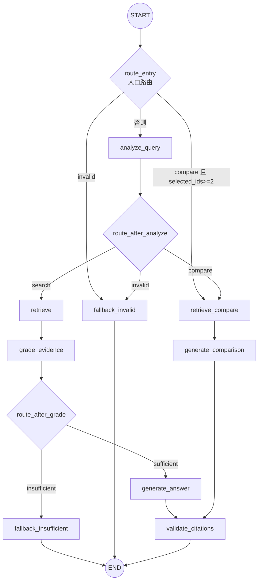

# LangGraph 工作流图结构

> 对应代码：`backend/app/agents/graph.py`
> 状态定义：`backend/app/agents/state.py`
> 节点实现：`backend/app/agents/nodes/`

## 1. 完整图（Mermaid）



## 2. 简化 ASCII 图

```
                        ┌─────┐
                        │START│
                        └──┬──┘
                    route_entry（条件边）
          ┌──────────────┼───────────────────┐
          │              │                   │
    [invalid]    [compare+ids>=2]        [其他]
          │              │                   │
          ▼              ▼                   ▼
  fallback_invalid  retrieve_compare    analyze_query
          │              │                   │
          │              │          route_after_analyze（条件边）
          │              │        ┌──────────┼──────────┐
          │              │        │          │          │
          │              │   [invalid]   [compare]   [search]
          │              │        │          │          │
          │              │        ▼          │          ▼
          │              │  fallback_invalid │      retrieve
          │              │        │          │          │
          │              │        │          │          ▼
          │              │        │          │    grade_evidence
          │              │        │          │          │
          │              │        │          │   route_after_grade（条件边）
          │              │        │          │     ┌─────┴──────┐
          │              │        │          │ [sufficient] [insufficient]
          │              │        │          │     │            │
          │              │        │          │     ▼            ▼
          │              │        │          │ generate_answer fallback_insufficient
          │              │        │          │     │
          │              │        ▼          │     │
          │              │  generate_comparison     │
          │              │        │          │     │
          │              │        ▼          ▼     │
          │              │  validate_citations ◄───┘
          │              │        │
          ▼              ▼        ▼
         END            END      END
```

## 3. 节点职责（9 个业务节点）

| 节点 | 职责 | 调 LLM | 调 Milvus |
|---|---|---|---|
| `analyze_query` | 意图分类（search/compare/invalid）+ 抽取过滤条件与调查 id | 小模型 | 否 |
| `retrieve` | 混合检索取 top-k 证据段落，按调查聚合排序 | 否 | 是 |
| `grade_evidence` | 判断证据是否充分（规则优先，必要时小模型打分） | 小模型 | 否 |
| `generate_answer` | 生成带引用的三段式答案（条件/发现/解读） | 主模型 | 否 |
| `retrieve_compare` | 对两个调查分别检索证据 | 否 | 是 |
| `generate_comparison` | 生成结构化对比（先条件差异、再跨研究结论） | 主模型 | 否 |
| `validate_citations` | 校验每个 `[citation_id]` 能解析到真实段落，剔除幻觉引用 | 否（纯代码） | 否 |
| `fallback_insufficient` | 弱证据兜底响应 | 否 | 否 |
| `fallback_invalid` | 空/非法问题兜底响应 | 否 | 否 |

## 4. 条件边（3 个路由函数）

| 路由函数 | 位置 | 判断逻辑 | 分支 |
|---|---|---|---|
| `route_entry` | `START` 之后 | compare 且 selected_ids>=2 → 对比；invalid → 非法；否则 → 分析 | `retrieve_compare` / `fallback_invalid` / `analyze_query` |
| `route_after_analyze` | `analyze_query` 之后 | 按意图分类 | `retrieve` / `retrieve_compare` / `fallback_invalid` |
| `route_after_grade` | `grade_evidence` 之后 | 证据是否充分 | `generate_answer` / `fallback_insufficient` |

## 5. 典型流转路径

| 场景 | 路径 |
|---|---|
| 普通问答（search） | `START → analyze_query → retrieve → grade_evidence → generate_answer → validate_citations → END` |
| 对比（compare） | `START → retrieve_compare → generate_comparison → validate_citations → END` |
| 证据不足 | `START → analyze_query → retrieve → grade_evidence → fallback_insufficient → END` |
| 非法/空问题 | `START → fallback_invalid → END`（或 `analyze_query → fallback_invalid`） |

## 6. 关键设计点

- **单图多节点 = 轻量多 agent**：意图识别和证据打分用 `small_model`，摘要/对比用 `llm_model`（都是 DeepSeek，可通过 `.env` 分开配置）。
- **检索与生成分离**：`retrieve` 只取证据，`generate_*` 只基于证据生成，中间用 `grade_evidence` 做充分性闸门（对应 PRD 的 RAG 要求）。
- **引用防幻觉靠代码**：`validate_citations` 是纯代码（不调 LLM），把答案里的 `[evidence_id]` 与真实段落比对，保证每个引用都可溯源。
- **compare 直达**：`/api/compare` 端点直接在 state 里注入 `question_type=compare` + `selected_ids`，由 `route_entry` 跳过意图识别，少一次 LLM 调用、避免误判。
