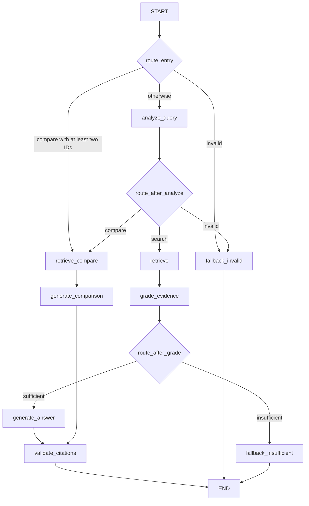

# LangGraph workflow

Implementation: `app/agents/graph.py`. State: `app/agents/state.py`. Nodes: `app/agents/nodes/`.

| Node | Responsibility | External service |
|---|---|---|
| analyze_query | Classify intent and extract explicit filters and investigation IDs | Small language model |
| retrieve | Retrieve and rank evidence passages by investigation | Milvus |
| grade_evidence | Assess evidence sufficiency with rules and model grading where needed | Small language model |
| generate_answer | Generate conditions, findings, and interpretation with citations | Main language model |
| retrieve_compare | Retrieve evidence for each selected investigation | Milvus |
| generate_comparison | Compare experimental conditions before conclusions | Main language model |
| validate_citations | Check cited IDs against retrieved passages and suppress unsupported answers | None |
| fallback_insufficient | Return an insufficient-evidence response | None |
| fallback_invalid | Return an invalid-question response | None |

The comparison endpoint sets the comparison intent and selected IDs directly, so it skips query classification. Search requests pass through evidence grading before answer generation.

This is one graph with multiple workflow nodes. Model names are configurable through the environment. Retrieval and generation remain separate. Citation validation checks that IDs resolve to retrieved passages; it does not prove that every scientific claim follows from its cited passage.
